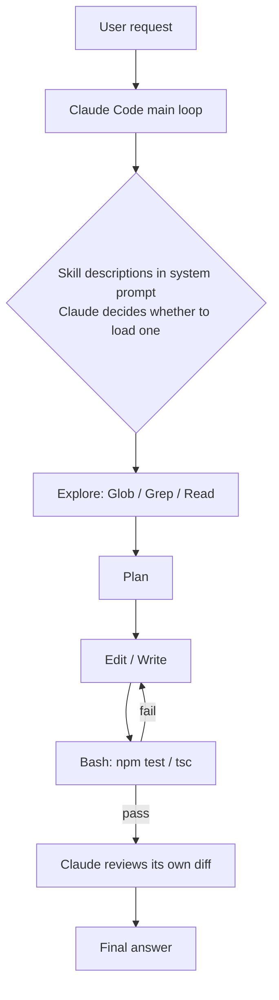
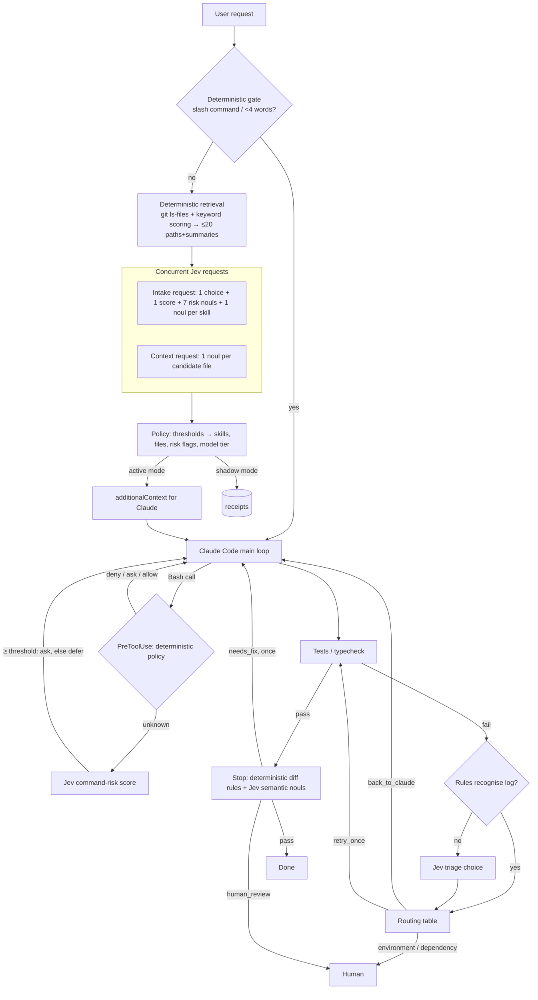

# Architecture: Jev as a typed decision layer around Claude Code

This document describes how the harness in this repo is built and where each responsibility lives.
Whether each Jev decision is *worth* making is a separate question, answered with measurements in
[findings.md](https://github.com/chhetri123/agent-workflow/blob/claude/elegant-knuth-dyyyzz/docs/findings.md).

## 1. What Jev is (and is not)

Jev ("System One" model from TypeSafe AI) does not generate text. A request is one **state**
(text or JSON) plus a map of named, typed **questions**. Every answer is a typed value:

| Primitive | Question shape | Answer (SDK `@typesafe-ai/sdk` 0.6.0) |
|---|---|---|
| `noul(instructions, {true?, false?})` | yes / no | `{ type: "noul", noul: P(yes) }` |
| `choice(instructions, {label: description, …})` | one of N labels (≤255) | `{ type: "choice", choice, confidence, probabilities }` |
| `score(instructions, [level0, level1, …])` | position on an ordered rubric | `{ type: "score", score (expected value, may fall between levels), confidence, probabilities, legend }` |

`POST /v1/systemone` with `{model, state, questions}`, `GET /v1/models` (`jev-latest`, `jev-preview`;
responses name the pinned version, e.g. `jev-1.13.0`). Usage is reported per request; TypeSafe
prices input tokens only. Limits reported for Jev: 64k tokens for state + all questions, 32k for
state + the longest question.

Consequences for design:

* **The pattern is State → Questions → typed Answers → deterministic Action.** Jev never chooses an
  action directly; code maps typed answers through thresholds to an action from a closed set.
* **Jev cannot abstain.** Every `choice` here carries an explicit escape label (`unclear`) and every
  binary decision is phrased so that "no" is the safe default.
* **One request can carry many questions about the same state.** That is the cheap form of
  fan-out: the state is tokenised once. Requests with *different* states (prompt vs file list) are
  sent concurrently.
* **Confidence is a ranking signal, not a probability of being right.** Thresholds are fit per
  decision on labelled data (bench), never assumed.

## 2. Responsibility boundaries

| Responsibility | Owner | Why |
|---|---|---|
| Understanding the repo, planning, writing/refactoring code, writing tests, explaining | **Claude (coding LLM)** | open-ended generation and multi-step reasoning |
| Choosing the next tool inside a turn | **Claude** | it already decides this as part of its reasoning; a pre-decision would add a round trip per step |
| Task kind, skill relevance, risk flags, complexity | **Jev** (bounded `choice`/`noul`/`score`) | small typed judgments over the prompt |
| Re-ranking search results | **Jev** (`noul` per candidate) | relevance judgment over *paths + summaries the harness already retrieved* |
| Semantic diff checks (relevant? complete? suspicious?) | **Jev** (`noul`) | judgments regexes cannot make |
| Classifying a failure log the rules do not recognise | **Jev** (`choice`) | judgment over unstructured text |
| File access, search, retrieval | **deterministic code** | Jev never touches the filesystem |
| Command permissions (deny / ask / allow) | **deterministic code** | Jev can only move an *unknown* command to `ask`, never to `allow` |
| Secrets, sensitive paths, `.only`/`.skip`, `ts-ignore`, diff size | **deterministic code** | decidable by rules |
| Thresholds, model choice, review routing, retries, state transitions | **deterministic code** | policy must be auditable and testable |
| Git, test execution, side effects | **deterministic code** | |
| Final approval of risky changes | **human** | |

## 3. Baseline workflow (Claude + Skills)

This repository had no existing agent configuration (no CLAUDE.md, skills, hooks, MCP or CI) when
the work started, so the baseline is the standard Claude Code loop with project skills and a
CLAUDE.md, reproduced in the benchmark fixture (`bench/e2e/fixture` in [agent-workflow](https://github.com/chhetri123/agent-workflow)).

Where time and tokens go in this loop (measured in the end-to-end benchmark): exploration turns
(every turn re-sends the growing context), skills that are not loaded when relevant (convention
violations surface late or never), and self-review that cannot see what the hidden acceptance
criteria are.

## 4. Jev-assisted workflow

### Hooks (in-session integration)

`jev-agent init` writes `.agent/` config and four Claude Code hooks into `.claude/settings.json`.
All four run the same bundled entrypoint (`dist/jev-agent.mjs hook`, ~85–120 ms process overhead).

| Hook | Deterministic part | Jev part | What it may do in active mode |
|---|---|---|---|
| `UserPromptSubmit` | gate trivial prompts; keyword retrieval | intake + context ranking (two concurrent requests) | add `additionalContext` (skills to load, likely files, risk note) |
| `PreToolUse` (Bash) | deny/ask/allow regex policy on every simple command | risk score for *unknown* commands only | `deny` (policy), `ask` (policy or Jev); **never `allow`** |
| `PostToolUse` | record Skill/Read/Edit/Write/Bash for shadow scoring; detect failing test output; rule triage | triage choice when rules do not match | add `additionalContext` with the failure class |
| `Stop` | parse `git diff HEAD` + untracked files; secrets, sensitive paths, `.only/.skip`, `ts-ignore`, size | completeness, suspicious, per-file relevance | `systemMessage` (human review) or `decision: block` **at most once per prompt** |

### Orchestrator (out-of-session integration)

`jev-agent run "<task>" --workflow baseline|deterministic|jev [--route-model]` drives headless
Claude Code (`claude -p`, stream-json) and runs the outer loop itself: intake → Claude → tests →
triage → feedback (resume the same session) → patch verification → pass / one more round /
human review. Model routing only exists here: a hook cannot change the session's model.

## 5. Failure paths

| Failure | Behaviour |
|---|---|
| No API key, network error, timeout (default 3 s), 4xx/5xx | `Judge.ask` resolves `{ok:false}`, a `fallback` receipt is written, the hook returns nothing → normal Claude Code behaviour |
| Malformed hook input or any exception | the hook prints nothing and exits 0 |
| Jev answer under threshold / threshold `null` | decision is logged, never acted on |
| Stop-hook block would loop | blocked at most once per prompt (`stopBlocks` in `.agent/state`) and never when `stop_hook_active` |
| Jev says a dangerous command is safe | irrelevant: Jev is only consulted for commands no deny/ask rule matched, and it cannot allow |
| Jev flags a safe change for review | costs a human glance; measured as false-alarm rate in the bench |

## 6. Human review paths

A change is routed to a human, never auto-approved, when any of these hold:
deterministic sensitive-path / secret / deleted-test / size rule; Jev `suspicious ≥ threshold`;
intake risk flags `auth | migration | secrets | infra | destructive`; triage class
`environment | missing_dependency`. Review is a *signal* the harness surfaces (systemMessage,
`humanReview` in run results); merge permissions stay in your Git host.

## 7. Observability

Every Jev request writes one JSONL receipt to `.agent/receipts/<date>.jsonl`:
`purpose, session, mode, model (pinned version), latency_ms, usage, question names, answers, source (jev|fallback|deterministic), acted`.
`PostToolUse` writes `actual` receipts (skills Claude loaded, files it read/edited, commands it ran).
`jev-agent report` joins them per session: Jev's skill/file picks vs what Claude did, latency
percentiles, fallback rate and token cost. States (which can contain source) are not logged.
